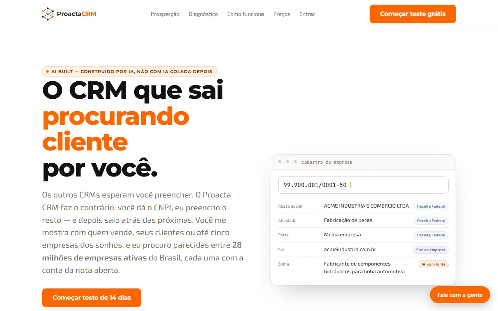
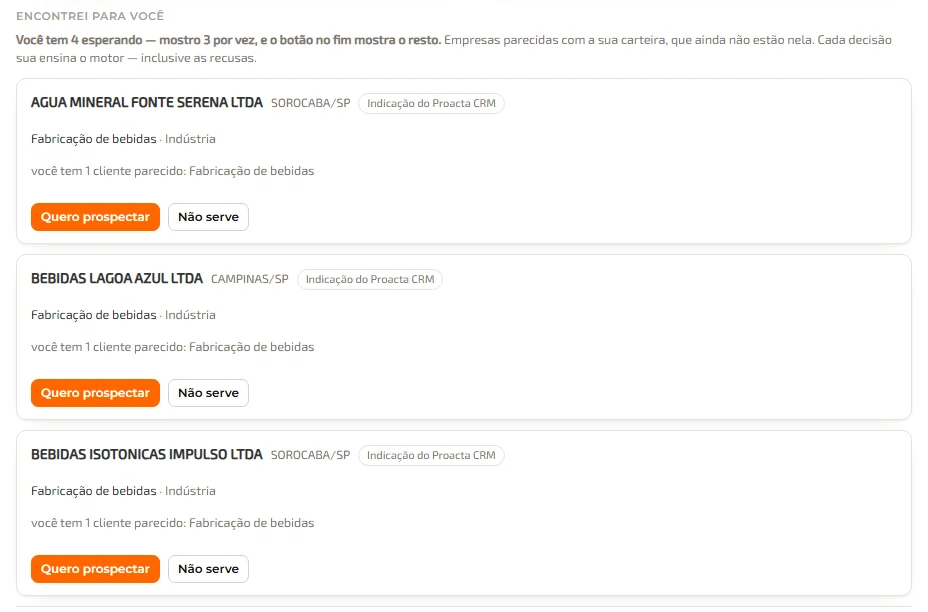
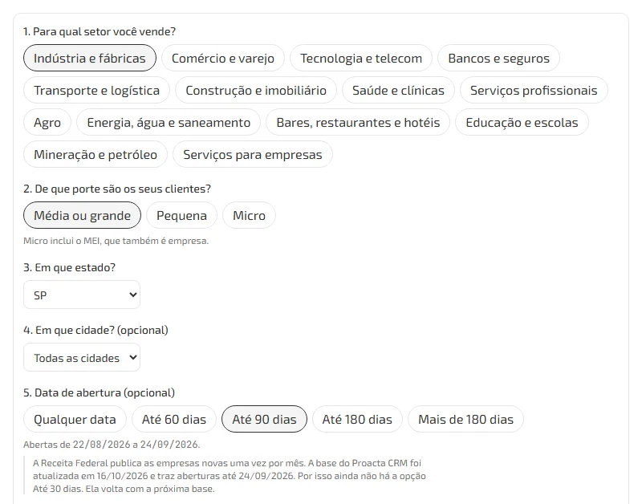
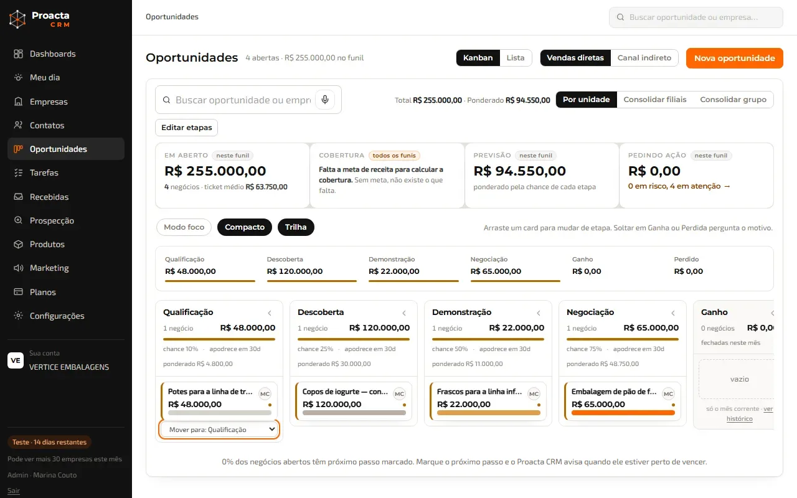
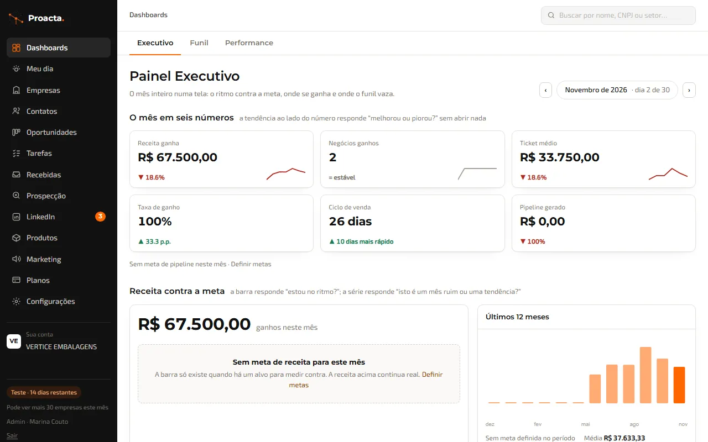

Proacta CRM is a B2B sales CRM for the Brazilian market that, instead of waiting for salespeople to fill it in, goes out looking for clients: the rep types a company's tax ID (CNPJ), the system fills in the rest and then suggests companies similar to the rep's portfolio, from a database of more than 28 million active companies. Nocodeia built the whole product, from the website to the software, and the MVP was ready 2 weeks after the first call.

<strong>2 weeks</strong>from the first call to a live MVP

<strong>28.6 million</strong>active companies in the database, updated every month

<strong>Zero typing</strong>to add a company: just the tax ID

<strong>14 days</strong>of free trial, no credit card, right from the website

## What was the problem?

Luiz Almeida, Proacta's Sales Director, knew the routine of B2B sales well: the CRM becomes an empty box that reps have to fill by hand. They type each company's legal name, address, industry and size, and still have to figure out on their own who to sell to next.

The idea was to flip that around. A CRM that comes with the whole market already inside, fills in the data on its own and points to the next companies to prospect. To work, the product had to handle a database of tens of millions of companies and stay fast.

## What did Nocodeia build?

The complete product, in three parts:

1. **The software**: a SaaS CRM with an account for each client company, users, permissions and a subscription plan.
2. **The company database**: the monthly load of Brazil's open company registry (CNPJ) from the Federal Revenue Service, which now adds up to 28,654,371 active companies in Proacta's count, including sole proprietors and branches.
3. **The website**, [proactacrm.com](https://proactacrm.com/), with the text ready in the code so Google and AI tools read it on the first visit, and sign-up for the 14-day trial.

<figure class="tela"><figcaption>The Proacta website (in Portuguese): the promise right at the top and the 14-day trial one click away.</figcaption></figure>

## How does Proacta find clients?

Companies are added by tax ID. The rep types the number and Proacta pulls the legal name, business activity, size, address and website, with nobody typing anything else. The team calls this "Zero Input".

Then the recommendation engine compares the client's portfolio with the database and suggests similar companies that aren't in it yet. Each suggestion comes with the reason, such as "you have 6 similar clients", and two buttons: "I want to prospect" or "Not a fit". The engine learns from both answers, including the rejections.

<figure class="tela"><figcaption>Recommendations: companies similar to the portfolio, with the reason for each suggestion. Demo data.</figcaption></figure>

For building a list from scratch, prospecting filters the database by industry, size, state, city and founding date. For example, you can find mid-sized manufacturers in São Paulo opened in the last 90 days.

<figure class="tela"><figcaption>Prospecting the database: industry, size, state, city and founding date.</figcaption></figure>

## What else is there besides prospecting?

Everything a sales team uses day to day:

- **Sales pipeline** in kanban, with value per stage, a forecast weighted by each stage's probability and alerts for stalled deals.
- **My day**, each rep's home screen, with tasks, priorities and new recommendations.
- **Dashboards** for revenue, pipeline and performance, compared against the target.
- **LinkedIn invitation** prepared by the system and approved by the rep before it goes out.
- **Role-based permissions** and data protection under Brazil's LGPD: legal basis, opt-out requests, a block list and a data processing agreement.

<figure class="tela"><figcaption>Kanban pipeline: open value, weighted forecast and what needs action. Demo data.</figcaption></figure>

<figure class="tela"><figcaption>Executive dashboard: the month in six numbers, with the trend next to each one. Demo data.</figcaption></figure>

## How was the MVP ready in 2 weeks?

The project started on August 21, 2026 and was split into slices. Each slice has its own specification, plan and automated tests, and goes live as soon as it passes review. Adding companies by tax ID was the first slice; the pipeline, tasks and dashboards came in the next ones.

AI agents write and review the code under Nocodeia's supervision, which speeds up delivery without skipping review. Each client company's data is kept separate in the database itself: every query returns only what that account is allowed to see, even if a screen gets it wrong.

> We wanted to build a smart SaaS CRM with 28 million active companies inside it, so the product had to be robust. From the first conversation with Nocodeia to the MVP launch, it took 2 weeks.
>
> — Luiz Almeida, Sales Director at Proacta CRM

## What were the results?

- **MVP live in 2 weeks**, counting from the first call.
- **More than 2,100 code changes** in the first 3 months: the product kept evolving after the MVP.
- **A database of 28.6 million active companies**, updated every month with the Federal Revenue Service load.
- **14-day trial open on the website**, no credit card required.

Proacta is in its launch phase, so this case covers how the product was built, not its clients' sales. We'll update this page when those numbers come in.

To see the product in a real prospecting scenario, read our guide to the [Brazil company database](/en/blog/brazil-company-database/).

## FAQ

### How long does it take to build a custom CRM?

Proacta's MVP was ready in 2 weeks. At Nocodeia, an MVP takes 2 to 6 weeks, and larger systems take 1 to 3 months, always delivered in slices that go live along the way. The fixed deadline comes out of the free diagnosis.

### Is it better to build your own CRM or subscribe to an existing one?

If an off-the-shelf CRM does the job, subscribe. Building your own makes sense when the CRM is the product itself, as with Proacta, or when your sales process doesn't fit the tools on the market without workarounds.

### Do the data and the code belong to the client company?

Yes. In Nocodeia projects, the domain, accounts, code and data are in the client company's name from day one.

## Has your sales process outgrown your CRM?

Whether it's a CRM, a portal or a product to sell, Nocodeia builds it in weeks and keeps improving it with you. In the free 45-minute diagnosis, we learn how your process works and tell you honestly whether custom software is worth it. See our [custom software and products](/en/#systems-and-products) and [book your free diagnosis](/en/#diagnostico).
