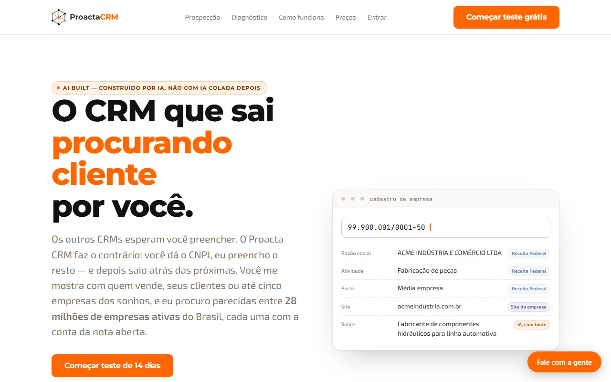
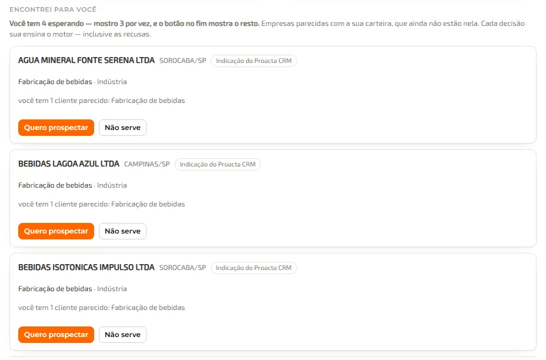
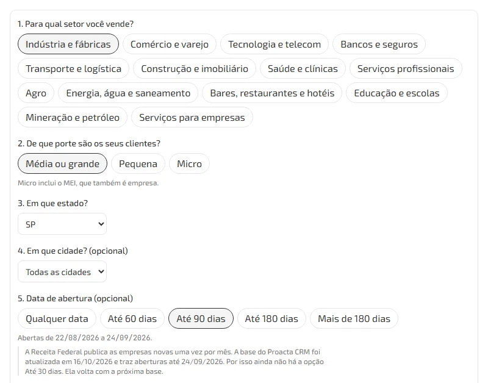
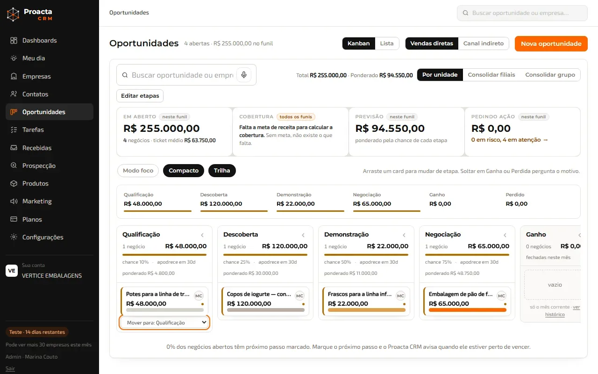
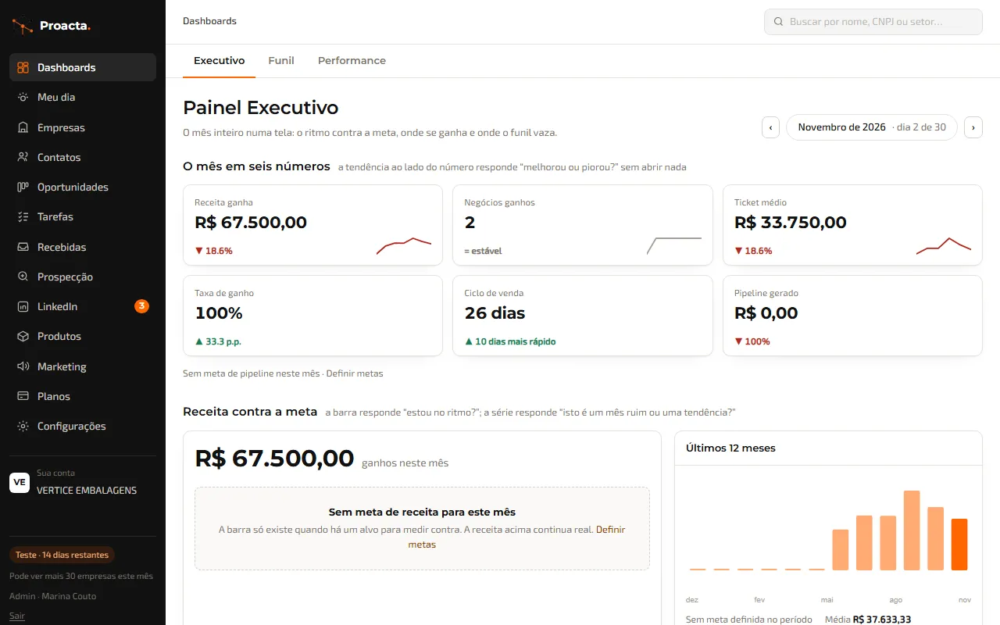

Proacta CRM es un CRM de ventas B2B para el mercado brasileño que, en lugar de esperar a que el vendedor lo llene, sale a buscar clientes: el vendedor escribe el número fiscal de la empresa (CNPJ), el sistema completa el resto y después sugiere empresas parecidas a su cartera, en una base de más de 28 millones de empresas activas. Nocodeia construyó el producto completo, del sitio al sistema, y el MVP estuvo listo 2 semanas después de la primera conversación.

<strong>2 semanas</strong>de la primera conversación al MVP en línea

<strong>28,6 millones</strong>de empresas activas en la base, actualizada cada mes

<strong>Cero tipeo</strong>para registrar una empresa: solo el CNPJ

<strong>14 días</strong>de prueba gratis, sin tarjeta, directo en el sitio

## ¿Cuál era el problema?

Luiz Almeida, Director de Ventas de Proacta, conocía bien la rutina de quien vende a empresas: el CRM se vuelve una caja vacía que el vendedor tiene que llenar a mano. Escribe la razón social, la dirección, el sector y el tamaño de cada empresa, y además tiene que descubrir solo a quién venderle después.

La idea era invertir eso. Un CRM que ya nace con el mercado entero adentro, completa los datos solo y señala las próximas empresas a prospectar. Para funcionar, el producto tenía que soportar una base con decenas de millones de empresas y seguir siendo rápido.

## ¿Qué construyó Nocodeia?

El producto completo, en tres partes:

1. **El sistema**: un CRM en SaaS con una cuenta para cada empresa cliente, usuarios, permisos y plan de suscripción.
2. **La base de empresas**: la carga mensual del registro abierto de empresas de Brasil (CNPJ) de la Receita Federal, que hoy suma 28.654.371 empresas activas en el conteo de Proacta, incluyendo microempresas y sucursales.
3. **El sitio** [proactacrm.com](https://proactacrm.com/), con el texto listo en el código para que Google y las IA lo lean en la primera visita, y registro para la prueba de 14 días.

<figure class="tela"><figcaption>El sitio de Proacta (en portugués): la promesa arriba de todo y la prueba de 14 días a un clic.</figcaption></figure>

## ¿Cómo busca clientes Proacta?

El registro es por CNPJ. El vendedor escribe el número y Proacta trae la razón social, la actividad, el tamaño, la dirección y el sitio de la empresa, sin que nadie escriba nada más. El equipo lo llama "Zero Input".

Después, el motor de recomendaciones compara la cartera del cliente con la base y sugiere empresas parecidas que todavía no están en ella. Cada sugerencia trae el motivo, como "tienes 6 clientes parecidos", y dos botones: "Quiero prospectar" o "No sirve". El motor aprende de las dos respuestas, incluso de los rechazos.

<figure class="tela"><figcaption>Recomendaciones: empresas parecidas a la cartera, con el motivo de cada sugerencia. Datos de demostración.</figcaption></figure>

Para armar una lista desde cero, la prospección filtra la base por sector, tamaño, estado, ciudad y fecha de apertura. Por ejemplo, se pueden encontrar las industrias medianas de São Paulo abiertas en los últimos 90 días.

<figure class="tela"><figcaption>Prospección en la base: sector, tamaño, estado, ciudad y fecha de apertura.</figcaption></figure>

## ¿Qué hay además de la prospección?

Todo lo que un equipo comercial usa en el día a día:

- **Embudo de ventas** en kanban, con valor por etapa, previsión ponderada por la probabilidad de cada etapa y alerta de negocios estancados.
- **Mi día**, la pantalla de inicio de cada vendedor, con tareas, prioridades y recomendaciones nuevas.
- **Paneles** de ingresos, embudo y desempeño, comparados con la meta.
- **Invitación en LinkedIn** preparada por el sistema y aprobada por el vendedor antes de salir.
- **Permisos por perfil** y protección de datos según la LGPD de Brasil: base legal, pedido de oposición, lista de bloqueo y contrato de tratamiento de datos.

<figure class="tela"><figcaption>Embudo en kanban: valor abierto, previsión ponderada y lo que pide acción. Datos de demostración.</figcaption></figure>

<figure class="tela"><figcaption>Panel ejecutivo: el mes en seis números, con la tendencia al lado de cada uno. Datos de demostración.</figcaption></figure>

## ¿Cómo estuvo listo el MVP en 2 semanas?

El proyecto empezó el 21 de agosto de 2026 y se dividió en partes. Cada parte tiene su especificación, su plan y sus pruebas automáticas, y sale en línea en cuanto pasa la revisión. El registro por CNPJ fue la primera parte; el embudo, las tareas y los paneles vinieron en las siguientes.

Agentes de IA escriben y revisan el código con la supervisión de Nocodeia, lo que acelera la entrega sin saltarse la revisión. Los datos de cada empresa cliente quedan separados en la propia base de datos: cada consulta devuelve solo lo que esa cuenta puede ver, aunque una pantalla se equivoque.

> Queríamos crear un CRM inteligente en SaaS con 28 millones de empresas activas dentro, así que el producto tenía que ser robusto. De la primera conversación con Nocodeia al MVP lanzado pasaron 2 semanas.
>
> — Luiz Almeida, Director de Ventas de Proacta CRM

## ¿Cuáles fueron los resultados?

- **MVP en línea en 2 semanas**, desde la primera conversación.
- **Más de 2.100 cambios en el código** en los 3 primeros meses: el producto siguió evolucionando después del MVP.
- **Base de 28,6 millones de empresas activas**, actualizada cada mes con la carga de la Receita Federal.
- **Prueba de 14 días abierta en el sitio**, sin tarjeta de crédito.

Proacta está en fase de lanzamiento, por eso este caso habla de la construcción del producto y no de las ventas de sus clientes. Cuando esos números cierren, vamos a actualizar esta página.

Para ver el producto en una prospección real, lee nuestra guía de [prospección B2B con IA en Brasil](/es/blog/prospeccion-b2b-con-ia-en-brasil/).

## Preguntas frecuentes

### ¿Cuánto tiempo lleva crear un CRM a medida?

El MVP de Proacta estuvo listo en 2 semanas. En Nocodeia, un MVP lleva de 2 a 6 semanas, y los sistemas más grandes, de 1 a 3 meses, siempre entregados en partes que ya salen en línea. El plazo cerrado sale del diagnóstico gratuito.

### ¿Conviene más crear un CRM propio o contratar uno listo?

Si el CRM listo resuelve, contrátalo. Tiene sentido crear el tuyo cuando el CRM es el propio producto, como en Proacta, o cuando tu proceso de ventas no cabe en las herramientas del mercado sin parches.

### ¿Los datos y el código quedan a nombre de la empresa?

Sí. En los proyectos de Nocodeia, el dominio, las cuentas, el código y los datos quedan a nombre de la empresa cliente desde el primer día.

## ¿Tu proceso de ventas no cabe en el CRM que usas?

Sea un CRM, un portal o un producto para vender, Nocodeia lo construye en semanas y sigue evolucionándolo contigo. En el diagnóstico gratuito de 45 minutos, entendemos tu proceso y te decimos con franqueza si vale la pena hacerlo a medida. Conoce nuestros [sistemas y productos a medida](/es/#sistemas-y-productos) y [agenda tu diagnóstico gratis](/es/#diagnostico).
