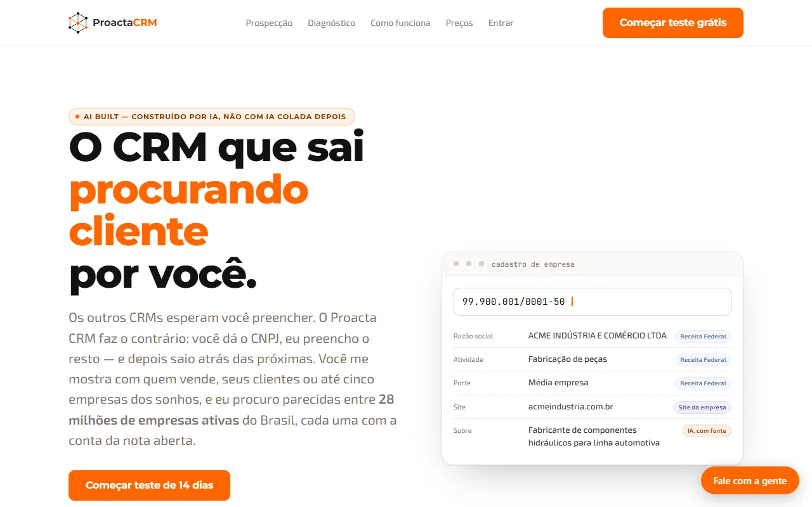
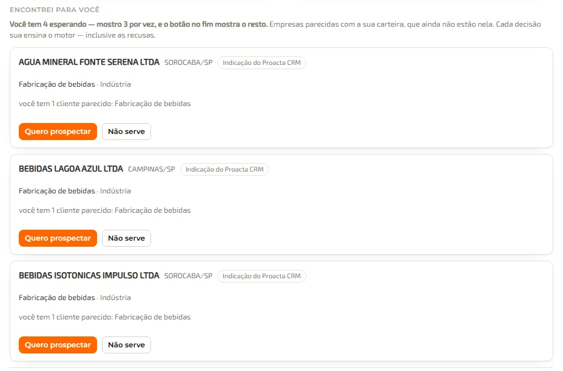
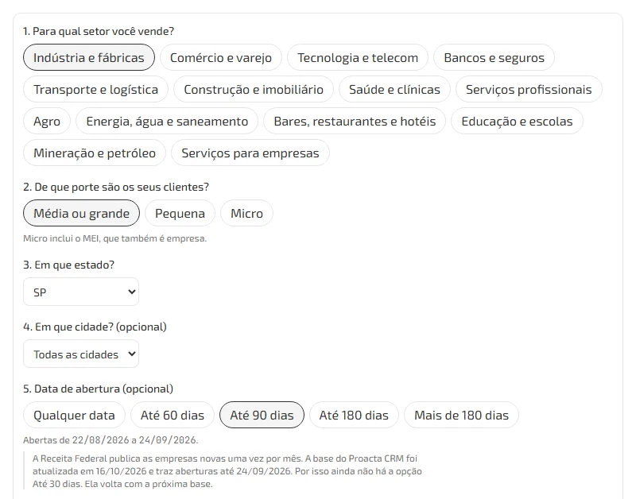
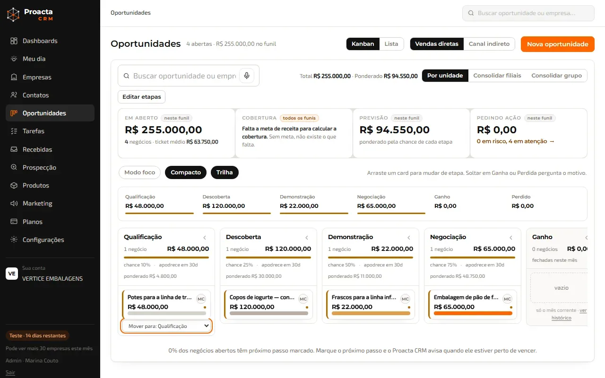
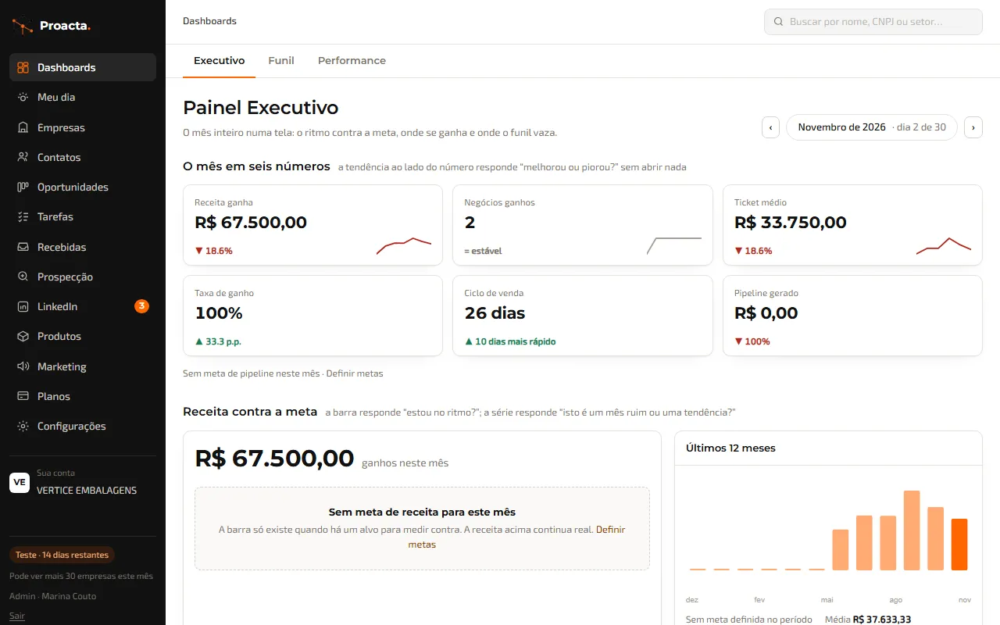

O Proacta CRM é um CRM de vendas B2B que, em vez de esperar o vendedor preencher, sai procurando cliente: o vendedor digita o CNPJ, o sistema preenche o resto e depois sugere empresas parecidas com a carteira dele, numa base de mais de 28 milhões de empresas ativas. A Nocodeia construiu o produto inteiro, do site ao sistema, e o MVP ficou pronto 2 semanas depois da primeira conversa.

<strong>2 semanas</strong>da primeira conversa ao MVP no ar

<strong>28,6 milhões</strong>de empresas ativas na base, atualizada todo mês

<strong>Zero digitação</strong>para cadastrar empresa: só o CNPJ

<strong>14 dias</strong>de teste grátis, sem cartão, direto no site

## Qual era o problema?

O Luiz Almeida, Diretor de Vendas do Proacta, conhecia bem a rotina de quem vende para empresas: o CRM vira uma caixa vazia que o vendedor precisa encher à mão. Ele digita razão social, endereço, setor e porte de cada empresa, e ainda precisa descobrir sozinho para quem vender depois.

A ideia era inverter isso. Um CRM que já nasce com o mercado inteiro dentro, preenche os dados sozinho e aponta as próximas empresas para prospectar. Para funcionar, o produto precisava aguentar uma base com dezenas de milhões de empresas e continuar rápido.

## O que a Nocodeia construiu?

O produto completo, em três partes:

1. **O sistema**, um CRM em SaaS com conta para cada empresa cliente, usuários, permissões e plano de assinatura.
2. **A base de empresas**, com a carga mensal da base aberta do CNPJ da Receita Federal, que hoje soma 28.654.371 empresas ativas na contagem do Proacta, incluindo MEIs e filiais.
3. **O site** [proactacrm.com](https://proactacrm.com/), com o texto pronto no código para o Google e as IAs lerem na primeira visita, e cadastro para o teste de 14 dias.

<figure class="tela"><figcaption>O site do Proacta: a promessa logo no topo e o teste de 14 dias a um clique.</figcaption></figure>

## Como o Proacta procura clientes?

O cadastro é por CNPJ. O vendedor digita o número e o Proacta busca razão social, atividade, porte, endereço e site da empresa, sem ninguém digitar mais nada. A equipe chama isso de "Zero Input".

Depois, o motor de indicações compara a carteira do cliente com a base e sugere empresas parecidas que ainda não estão nela. Cada sugestão traz o motivo, como "você tem 6 clientes parecidos", e dois botões: "Quero prospectar" ou "Não serve". O motor aprende com as duas respostas, inclusive com as recusas.

<figure class="tela"><figcaption>Indicações: empresas parecidas com a carteira, com o motivo de cada sugestão. Dados de demonstração.</figcaption></figure>

Para quem quer montar uma lista do zero, a prospecção filtra a base por setor, porte, estado, cidade e data de abertura. Dá para achar, por exemplo, as indústrias de médio porte de São Paulo abertas nos últimos 90 dias.

<figure class="tela"><figcaption>Prospecção na base: setor, porte, estado, cidade e data de abertura.</figcaption></figure>

## O que tem além da prospecção?

Tudo o que um time comercial usa no dia a dia:

- **Funil de vendas** em kanban, com valor por etapa, previsão ponderada pela chance de cada etapa e alerta de negócio parado.
- **Meu dia**, a tela de abertura de cada vendedor, com as tarefas, as prioridades e as indicações novas.
- **Painéis** de receita, funil e desempenho, com a comparação contra a meta.
- **Convite no LinkedIn** preparado pelo sistema e aprovado pelo vendedor antes de sair.
- **Permissões por perfil** e cuidados de LGPD: base legal, pedido de oposição, lista de bloqueio e contrato de tratamento de dados.

<figure class="tela"><figcaption>Funil em kanban: valor em aberto, previsão ponderada e o que pede ação. Dados de demonstração.</figcaption></figure>

<figure class="tela"><figcaption>Painel executivo: o mês em seis números, com a tendência ao lado de cada um. Dados de demonstração.</figcaption></figure>

## Como o MVP ficou pronto em 2 semanas?

O projeto começou em 21 de agosto de 2026 e foi dividido em fatias. Cada fatia tem a sua especificação, o seu plano e os seus testes automáticos, e vai para o ar assim que passa na revisão. O cadastro por CNPJ foi a primeira fatia, e o funil, as tarefas e os painéis vieram nas seguintes.

Agentes de IA escrevem e revisam o código com a supervisão da Nocodeia, o que acelera a entrega sem pular a revisão. Os dados de cada empresa cliente ficam separados no próprio banco de dados: cada consulta devolve só o que aquela conta pode ver, mesmo se a tela errar.

> Queríamos criar um CRM inteligente em SaaS com 28 milhões de empresas ativas dentro dele, então o produto precisava ser robusto. Da primeira conversa com a Nocodeia até o MVP lançado foram 2 semanas.
>
> — Luiz Almeida, Diretor de Vendas do Proacta CRM

## Quais foram os resultados?

- **MVP no ar em 2 semanas**, a partir da primeira conversa.
- **Mais de 2.100 alterações no código** nos 3 primeiros meses: o produto não parou de evoluir depois do MVP.
- **Base de 28,6 milhões de empresas ativas**, atualizada todo mês com a carga da Receita Federal.
- **Teste de 14 dias aberto no site**, sem cartão de crédito.

O Proacta está em fase de lançamento, por isso este case fala da construção do produto e não de vendas dos clientes dele. Quando esses números fecharem, esta página vai ser atualizada.

Para ver o produto em ação numa prospecção de verdade, leia o nosso guia de [prospecção B2B com IA](/blog/prospeccao-b2b-com-ia/).

## Perguntas frequentes

### Quanto tempo leva para criar um CRM sob medida?

O MVP do Proacta ficou pronto em 2 semanas. Na Nocodeia, um MVP leva de 2 a 6 semanas, e sistemas maiores, de 1 a 3 meses, sempre entregues em fatias que já vão para o ar. O prazo fechado sai no diagnóstico gratuito.

### Vale mais a pena criar um CRM próprio ou assinar um pronto?

Se o CRM pronto resolve, assine. Faz sentido criar o seu quando o CRM é o próprio produto, como no Proacta, ou quando o seu processo de vendas não cabe nas ferramentas do mercado sem gambiarra.

### Os dados e o código ficam no nome da empresa?

Sim. Nos projetos da Nocodeia, domínio, contas, código e dados ficam no nome da empresa cliente desde o primeiro dia.

## O seu processo de vendas não cabe no CRM que você usa?

Seja um CRM, um portal ou um produto para vender, a Nocodeia constrói em semanas e continua evoluindo com você. No diagnóstico gratuito de 45 minutos, a gente entende o seu processo e diz com franqueza se vale fazer sob medida. Conheça os nossos [sistemas e produtos sob medida](/#sistemas-e-produtos) e [agende seu diagnóstico grátis](/#diagnostico).
